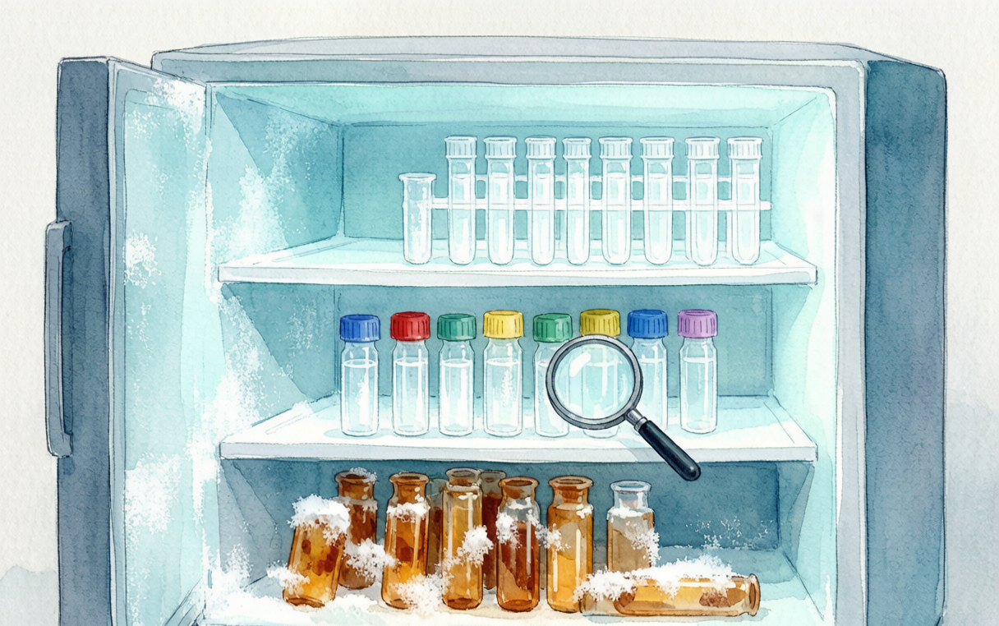

# 冰箱考古学：−20 °C里的时间胶囊

> 摘要：每个实验室都有一台装满"历史遗迹"的冰箱。整理试剂是一门技术，也是一次考古。

每个实验室都有一台这样的冰箱。

门一开，冷气扑在手腕上，冻得人一激灵。等眼睛适应了那层白霜，眼前的景象还是挺像考古现场的：底下躺着 2019 年的某管"不知道是什么"，中间挤着一排字迹已经糊掉的冻存管，里头半管抗体，标签上只写了个字母 G。

没有人知道 G 代表什么。问师兄，师兄说他来的时候它就在了。

## 冰箱里的地层

实验室冰箱有一种奇怪的引力。东西放进去就很难再出来，隔一阵子自发变多，直到塞得关不上门。

这个过程倒真跟考古地层有点像。底下那层是建室初期留下的，中间是历届研究生攒的，浅一点的地方才是最近放进去的。从下往上翻一遍，差不多能还原出这个实验室这几年的方向怎么变的。

翻下来第一个感受：标签是科研文明的地基。

可现实是，很多实验室的标签系统早就塌了。记号笔写的字在霜里一蹭就掉，标签纸被冷凝水泡烂，有些管子上干脆什么都没写。放进去的人当时觉得记得住，三个月后他就忘了。

## 抗体为什么不灵了

抗体保存是最常出问题的环节。

很多说明书写着 Store at −20 °C，但没人告诉你，−20 的冰箱一天开关几十次，实际温度在 −15 到 −25 之间来回荡。每次开门，冷凝水在管壁上凝一层，温度回升又重新冻上。反复冻融对蛋白结构的破坏是累积的。

一支抗体冻融五次以上，活性掉个三成到一半很常见。到第十次，剩下的多半是背景噪音。

所以拿到新抗体，标准动作是分装：按每次用量分到小管，写上名称、货号、日期和浓度，再放回 −20。用的时候取一管，用完扔掉，别让主 stock 反复进出冰箱。

这道理人人都知道，真做到的实验室大概一半。另一半的抗体，正在冰箱深处一点点失活。

## 整理这件事，迟做总比不做强

冰箱整理和写毕业论文有点像，都知道该做，都拖到要交才动手。

可行的办法是每季度审计一次。不用大动干戈，三件事就够。

先把管子全掏出来，能认的重新贴标签，认不出的单独放一盒，标"待确认"。两周后还是没人认领，就可以处理了。

再建一张清单：名称、货号、位置、存放日期、用量，贴在冰箱门上，取用登记。Excel 也行，实验室管理软件也行。

分区按温度来。上层温度偏高，适合放冻存盒、干冰备件这类不怕轻微波动的；中下层稳定，抗体和酶搁这儿；门架温度波动大，贵重试剂别塞那儿。

## 从考古到管理

冰箱整理说到底是个管理问题。冰箱有序，背后往往是个运转正常的实验室。

有的组会设一个冰箱管理员，通常交给低年级，职责是每季度张罗一次整理、维护清单、盯标签。这岗位听着不起眼，但所有人都得用冰箱，冰箱的秩序就落在这人身上。

我刚进实验室那年，师姐带着我们整理冰箱，翻出过一支十年前的冻存管，标签早看不清了，谁也不敢扔——万一是什么重要的中间品。这些年毕业了好几代人，走的时候都没顾上清理自己的"遗产"，等我们这一级，冰箱已经关不上门了。

下次开冰箱，花五分钟往里看一眼。你们组那管年头最久的，是哪一年的？我们这儿有一管 2013 的，至今没人敢动。

---

天放生物 | 品质可靠的生物试剂与专业的实验支持

抗体、试剂、耗材，来源可追溯，存储有规范

libereal.cn
