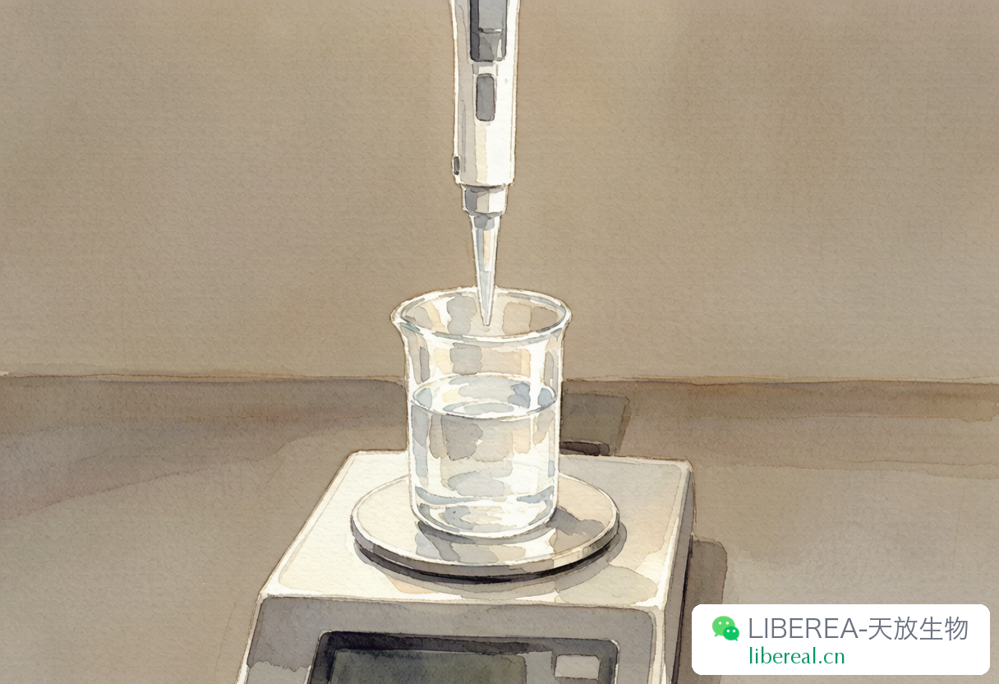
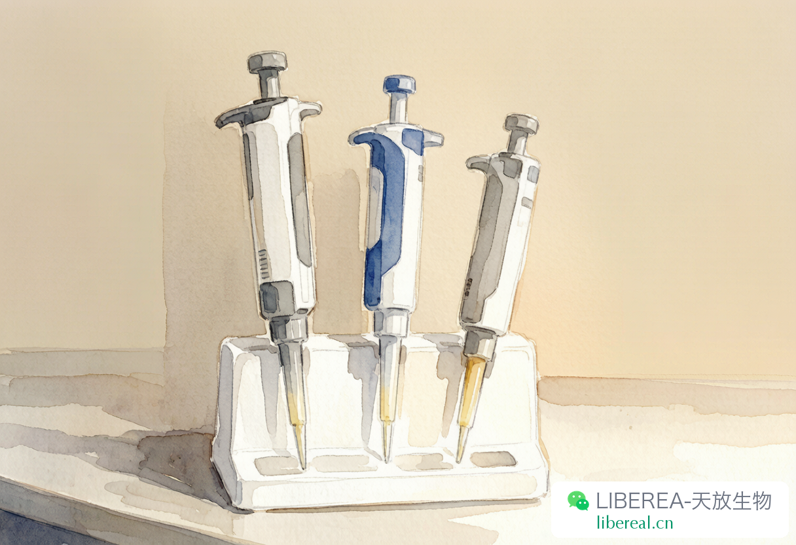

# 移液枪校准日：实验室最被忽视的仪式

> 摘要：实验室里服役多年的移液枪，准不准才是问题所在。聊聊校准这件容易被遗忘的事。

每个实验室大概都有一把"祖传"的移液枪。

这话我在好几个实验室都听过。服役八年十年的，枪头松了插上 tip 就漏液，刻度旋钮阻尼忽大忽小，但每个人用完还是放回原位，从来没人提过送它去校准。

你要问起来，回答基本都一样："还能用啊。"

我们做售后的，听到"还能用"这三个字就头疼。它约等于"我也不确定准不准，先凑合着"。

## 枪不准，实验真的白做

移液枪大概是实验室里一天到晚在动的东西。一天吸液上百次，配缓冲液、稀释抗体、铺细胞、加样跑 PCR，全靠它。每一次吸液都在积累误差，只不过你看不见。

吸出来的液体看着跟昨天没区别，实际体积可能已经偏了 5%、8% 甚至更多。这个偏差当天发现不了，等你重复实验怎么都复现不出来，才会慢慢觉出不对。

去年有个课题组做 ELISA，标准曲线连续三周画不好，复孔间变异系数飙到 15% 以上。他们换试剂、换操作人、换孵育时间，折腾一圈没解决。送到我们这边一测，那把 P200 弹簧老化，实际吸液量比刻度少了 12 微升。换了把校准过的枪，曲线立马就漂亮了。

三周时间，三个人的人力，搭在一把没校准的移液枪上。这笔账算下来挺亏的。

## 重量法：自己就能做

校准移液枪不用送专业机构，实验室自己就能搞。靠谱的办法是重量法。

原理不复杂：水的密度是已知的，室温下大概 0.998 g/mL，用分析天平称一下吸出来的水有多重，反推实际体积就行。

操作也不算麻烦。准备一台万分位天平（精度 0.1 mg 那种）、一管室温平衡过的超纯水、一个小称量杯。

设好量程，润洗 tip 三次——润洗是吸同一杯水排掉，来回三五次，让 tip 内壁挂上一层水膜，不是空吸空排。吸液的时候垂直插进液面，别太深，两三毫米够了。匀速慢慢吸，吸完停两秒让液面稳住。然后把液体打到称量杯里称重。重复十次，取平均值，算一下实际体积和变异系数。

合格标准我一般这么定：体积误差不超过标称值的 ±2%，变异系数不超过 1%。不同量程会有些区别，大体积允许误差小一些。这个标准不算严，但实验室自检够用。

整个过程也就半小时。半年做一次，基本能保证枪的精度在靠谱范围内。不是我较真，是数据这东西你不盯它，它就敢飘给你看。

## 日常用枪的几个习惯

校准是出了问题再补救，平时的习惯才是根本。这几点做到了，枪的精度寿命能长不少。

吸液要垂直。倾斜着吸会偏大，尤其是大体积的枪。养成垂直插液面的习惯，偏差能小一半——这个我们测过，不是瞎说。

换新 tip 之后先吸排两三次再正式用，让内壁挂上液膜。不润洗的话第一次吸液会偏小，因为有一部分液体沾在干壁上。

千万别拿移液枪当搅拌棒。去搅溶液很容易让液体倒吸进枪体，腐蚀活塞。活塞一旦生锈，精度基本就废了，修都修不回来。每年我们送修的枪，三成是这么坏的。

还有个小习惯，用完把量程调到最大。这样弹簧是放松的状态，不容易疲劳。坚持半年你会发现，自己那把枪比隔壁台子的明显准。

## 什么时候该送修

重量法校准如果发现偏差超过 5%，怎么调零都拉不回来，那基本是内部零件有问题了。这种情况别硬调，送修。

平时用的时候，如果感觉阻尼突然变了，吸液有气泡，或者排完液 tip 里总剩着一点，也都是该检修的信号。

移液枪就是个消耗件，不是传家宝。一把枪用十年不修不校准，不是省钱，是拿实验的可靠性在赌。我们组见过太多"赌输了"的案例，最后都是数据报废、实验重做。

下次进实验室，花十分钟给常用的那把枪做一次重量法校准。做完之后，你对自己的数据会有底气一点。

说到枪，我最好奇的是贵组那把服役年限最长的是几岁——我们见过 2009 年的，刻度都磨平了，还在跑 ELISA。

---

撰稿：售后-陈工 | 编辑：Sea | 校对：Peter

移液枪、tip 头、实验耗材，Labselect 品质稳定

libereal.cn
