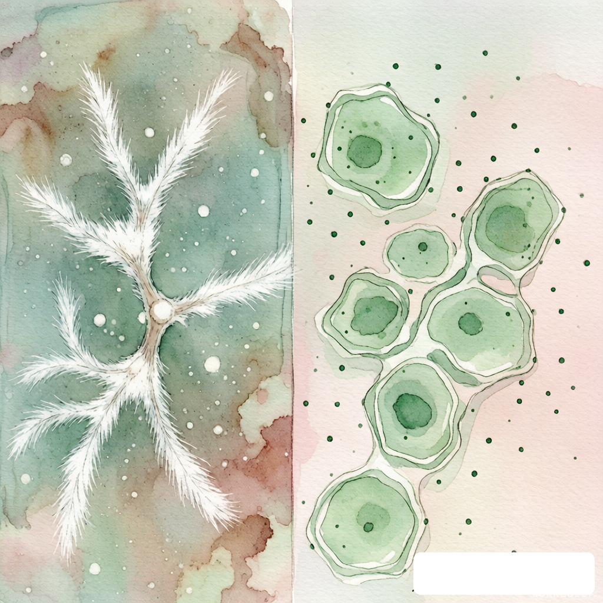
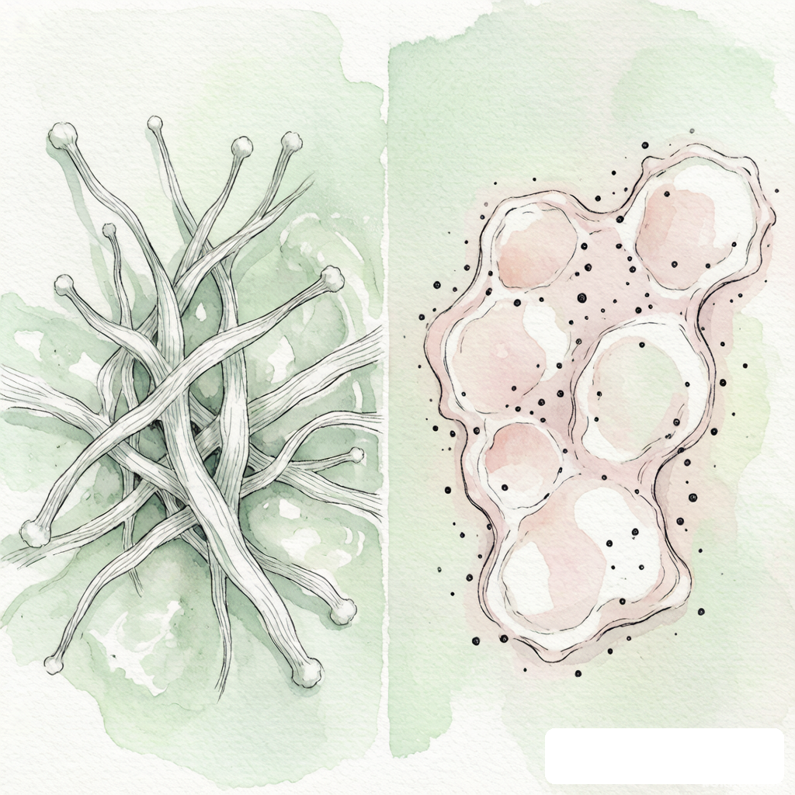

# 细胞培养污染鉴定图鉴：细菌真菌支原体一图分清

> 摘要：培养基突然变浑不一定都是细菌，细胞长得慢也不一定是你手潮。

细胞的求助电话里，十通有六通最后都指向同一个结论：污染了。

有意思的是，很多人开口就说"我细胞被细菌污染了"，真问到看见了什么，描述五花八门。培养基变黄、飘着小白点、细胞状态差、背景脏……这些症状背后可能是细菌、真菌、支原体，也可能只是培养基批间差。一上来就定性，实验很容易被带偏。

下面按我们售后和实验室对接的经验，把三种常见污染摊开讲。认清楚是什么，才好决定救还是扔。

## 细菌污染：来得快，看得清

细菌污染发作快，也相对好认。

通常半天到一天就能看出来。培养基从粉红转成黄色或橙黄，浑浊得像放了酵母的温水，有时候还能看到细颗粒在液体里游动。低倍镜下就是小黑点，高倍镜下形态规则，杆状、球状或螺旋状，做布朗运动或者主动游动。严重时细胞状态断崖下跌，贴壁细胞变圆、漂起来，好像一夜之间被团灭。

源头多半在操作环节。吸液管、tip 头灭菌不彻底，超净台滤网该换没换，手套碰到了瓶口边缘，都是常见原因。我们见过挺离谱的一次，是 PBS 瓶子放在台面上被空调水滴进去，整批细胞三天内全军覆没。

处理办法就是别救，直接扔。细胞、培养基、用过的 tip 头全部按生物危害废物处理，培养箱和超净台彻底消毒。想留种的话，同期冻存的细胞也要谨慎评估，最好重新复苏一支。

## 真菌污染：慢热，容易被放过

真菌比细菌慢，但更难缠。

初期可能只是培养基里冒出几个小白点，像碎纸屑或者小棉絮。细胞状态下降不明显，很多人第一反应是"培养基里怎么有沉淀"，不当回事。过两三天再看，白点开始拉丝、分叉，长成菌丝，这时候谁都知道是霉菌或者酵母了。镜下能看到丝状结构或出芽的酵母，和细胞边界很清楚。

孢子轻，飘得远。实验室里有一瓶长了霉，周围几个培养箱都得提起来。我们处理过一个案例，细胞房通风口旁边一盆绿萝长了霉菌，孢子顺着气流进了培养箱，整层楼的细胞断断续续污染了一个月才找到源头。

真菌污染同样建议直接弃掉。培养箱要用含抗真菌成分的消毒液彻底擦，加湿器水槽也要洗。孢子抵抗力比细菌强，喷两下酒精不一定杀得死。

## 支原体污染：看不见的那种

支原体麻烦就在于通常你看不见。

培养基颜色不一定变，细胞也不一定立刻漂。常见表现是增殖变慢、状态变差、转染效率下降、诱导分化做不出来，可你说具体哪里不对，又说不上来。不少课题组在这些"玄学"症状上折腾好几个月，换培养基、换血清、换操作人，兜了一大圈才想到查支原体。

检测方法有几种。PCR 最快，灵敏度高，适合定期筛查。荧光染色（比如 Hoechst 33258）能看到细胞核周围的微小荧光点，但需要经验判断。培养法结果硬，就是周期长，要几个星期。一般建议每三个月做一次支原体普查，共用的细胞系尤其该查。

处理起来更棘手。支原体没有细胞壁，青霉素、链霉素这类对它无效。市面上有专门针对支原体的清除试剂，但效果不稳定，也容易复发。这株细胞特别重要，可以试清除加连续检测；不太关键的话，省事的办法是重新引入一株确认干净的。

## 预防比鉴定更划算

污染发生后再鉴定，时间成本已经付出去了。日常盯紧几件事，能少踩很多坑。

人这一关其实最难。进细胞房换鞋、穿实验服、戴手套，老生常谈，真做到的实验室不多。环境那头，超净台滤网、培养箱水盘、加湿器都是高危区，定期清洁换水别偷懒。试剂这边，血清批间差、培养基开封太久、PBS 和胰酶反复取用，都可能带进东西。还有一条容易被忽略：细胞别到处串门，不同组共用细胞房，操作习惯和细胞背景都不一样，交叉污染的风险高得多。

我们组每年整理的细胞培养问题里，真正由试剂质量引起的比例并不高，多数还是操作习惯和环境管理。污染这事跟运气关系不大，跟细节关系很大。

下次看到细胞状态不对，先别急着怪培养基，也别一上来就喊"细菌污染了"。对着上面几条对一对，大概能省下几瓶细胞和一两个星期。

有没有那种全组查了半个月、最后发现源头在某个谁也没想到的角落的故事？我们碰到过源头是水浴锅的，从那以后那台锅就没干净过。

---

撰稿：技术支持-阿杰 | 编辑：Sea | 校对：Peter

天放生物 | 细胞培养试剂、培养基、耗材，品质稳定可溯源

libereal.cn
