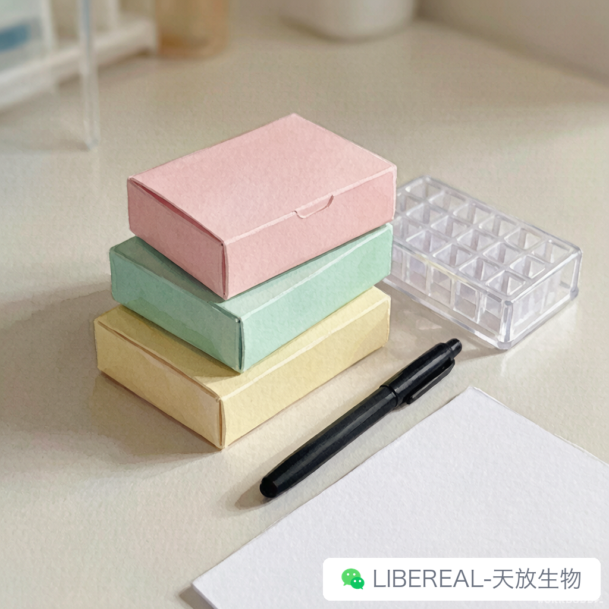

# 暑假试剂盘点：哪些该补货，哪些少囤

> 摘要：盘一半靠猜是常态，但这行干久了，眼睛和 Excel 都得修炼。

前几天一位 PI 发来个 Excel，38 行，整整齐齐。我点开一看，光二抗就列了五种型号、四个公司。打电话过去问，他自己也说不清为什么要买这么多。

这种单子接起来费劲。不是嫌麻烦，是知道最后大概率有七八项用不上，库存的地方就那么大，留着也是浪费。比起"啥都买"，暑假补货其实挺考验判断。

暑假前的采购窗口本来就挤：快递要查、冷链要协调，老师们发来的补货清单常常和实际差得有点远。

## 先盘使用频率，再盘消耗量

很多老师上来就问"你们那XX抗体还有现货吗"，顺序其实是反的。

先把自己组最近三个月的消耗清单拉出来，按 SKU 排一排，看哪些月月都要用，哪些仨月用了不到两支。前面那类铁定要补，后面那类基本可以不动。

我习惯把试剂按消耗速度分三档——快消品（培养基、tip 头、PBS）、稳态消耗（常用规格抗体、酶、引物）、慢销品（特殊标记试剂、即用型试剂盒、小众一抗）。

快消品囤多少按假期天数算。"最短消耗周期 × 实际放假天数 × 单次用量 × 1.5 倍余量"，看着粗暴，这么些年没断过供。之前有人按精确到天的计划算，结果假期被临时叫回来加做实验，第三天就清空了。

稳态消耗主要盯有效期。这部分库里常年有滚动库存，暑假前补一个季度的量就够，多了占资金。我们自己库里有过教训，某款二抗一次补了 50 支，用了大半年还没完，最后两支过期作废。

## 哪些千万别囤

耗材耐放，赶上活动多买点问题不大。试剂不行，"反正便宜多买点"往往是埋雷的开始——买的时候觉得占了便宜，用不完的时候没人认账。

判断标准其实就一条：这东西开封以后，能不能在一个稳定期内被用掉。

能共用的，可以考虑多备。胰酶、TrypLE 这类含酶溶液反复冻融活性会掉，开封后稳定期也短，但它们全组都在用，一瓶子几天就见底，开封即消化，囤着不亏。引物相反，外送的按需合成就行，库里压货没意义，自己分装的冻存还算稳。

各组方向不交叉、各买各的，就别按大组的量备。一瓶酶一学期只开两三次，剩下的时间都在冰箱里挨着，第二个月酶活就明显下去了，做出来的细胞贴壁率比平时低两成，你还不一定想得到是它。

即用型试剂盒更别囤，效期本来就贴着，运输再一折腾，到手可能已经不太合适。内切酶、连接酶同理，反复冻融是大忌，量大反而是负担。

冷链在夏天也容易翻车。我们自己发过的货，因为温度异常退货的批次有一半集中在七八月。所以补的时候得确认包材到位：泡沫箱里冰袋没化、包装完整、记录仪数据可查。这行没什么高深学问，靠的就是把"按规矩办事"养成肌肉记忆。

每年 6 月底我们采购组会做一次暑期预测，把历史数据和 PI 申报对一对，给个建议量。有老师愿意把清单发过来，我们顺手帮着核一下批次和效期，比自己一个个打电话问省事。

补货这件事，宁可少而精，也别多而杂。

你们组盘点的时候，是拿 Excel 老老实实对，还是全靠脑子记？我见过最猛的一位老师说"不用盘，我心里有数"，后来清出来四箱过期的。

---

撰稿：采购组-薅羊毛 | 编辑：Sea | 校对：Peter

天放生物 | 试剂现货批次透明，暑期冷链稳定发运

libereal.cn
