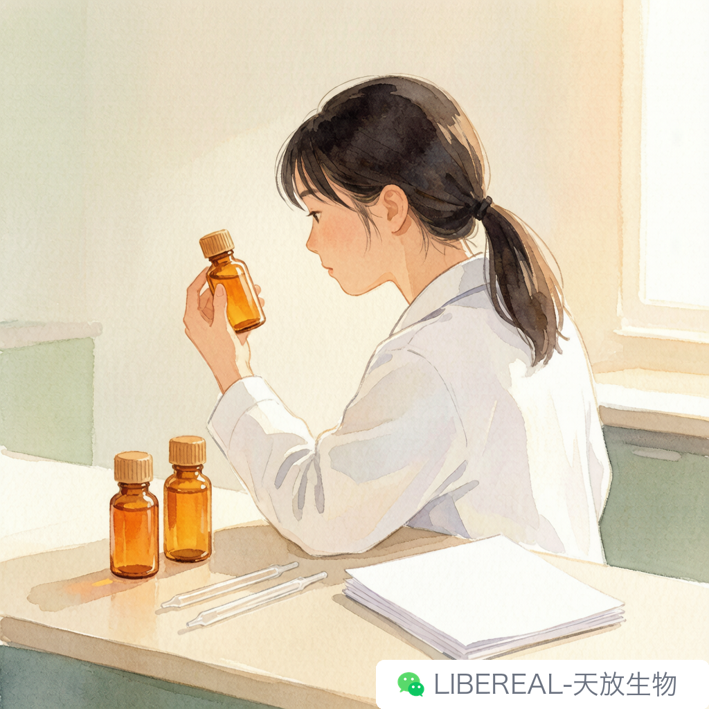
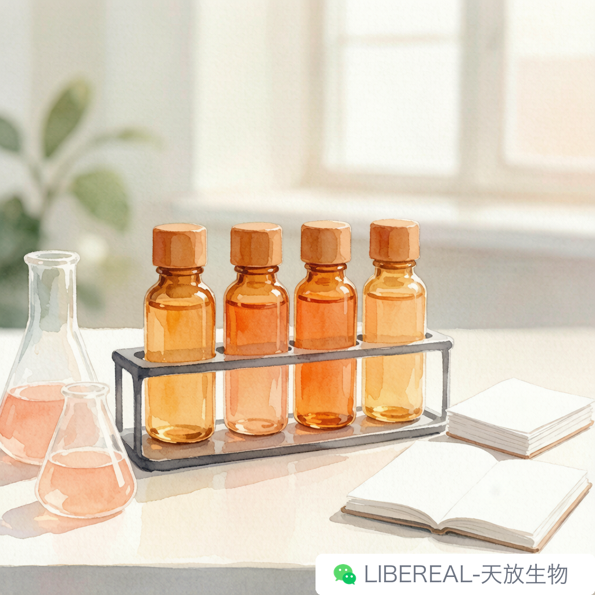

# 血清批次差异怎么破：从验收到底物适配

> 摘要：验收跳一步，适配就要多费一周的排查工夫。批次差异这事儿，功夫花在没出问题的时候才值。

上周有个电话，对面博士开口有点急："你们这批血清跟上批差太多，细胞贴壁率直接掉两成，是不是换供应商了？"

我让他拍个培养瓶的照片发过来，看了几秒，先安抚两句，然后问了句话："新批次有没有做完整验收？"

那边停顿几秒："就是看着没浑浊，就用了。"

得，问题八成就在这。

血清批次差异在细胞培养里翻车太常见，可几乎没人把它当回事。同一品牌、同一规格，批号从 022 跳到 023，养出来的细胞有时候像两个物种。这跟运气没关系，是流程的事。从拿到货开盖，到配进培养基里跟细胞对上眼，中间有几步没走完，差异就出来了。

## 验收不是"看着没浑浊"

很多实验室的标准动作是：到货，看颜色，摇一摇，丢冰箱。这离真正的验收还差得远。

真正要看的有三样。

头一个看 COA（出厂分析证书）上的内毒素和总蛋白落没落在标定范围。这两个值比货号本身重要得多。同样一栏里的小数点差几位，敏感细胞就能抖给你看。

再有就是外观，除了颜色还要看透明度。轻微析出的脂类会在瓶底形成一圈絮状物，肉眼看得见，摇几下又消失，这种常被当"正常"放过。

小样培养验证也得做一次。按日常用量配完全培养基，传两到三代细胞，看形态、增殖和贴壁率有没有漂移。这一步花不了一周，但漏了之后，所有实验数据都得带问号。

运输条件是另一个常被忽略的事。出厂数据再漂亮，路上一折腾，到了实验室未必还是那个状态。夏天尤其明显，我们接到的温度异常反馈，七八月能占到全年的多数。所以每个新批次都建议留一份自己的验证数据，照片归档，COA 留底，下次同批复购直接对比。批量采购的时候这步能省不少事。

## 底物适配：差异得看在什么实验上

血清里几十种已知和未知的成分，每批比例浮动是常态。所谓"批次差异"，在某些实验里几乎察觉不到，在另一些里就被放大到没法看。这件事我以前也是吃过亏才想明白的。

越敏感的细胞对批次越挑剔，这么多年做下来基本没变过。原代细胞、肝肾原代培养、特定干细胞株，对血清的偏执程度远高于 HeLa、HEK293 这种传代株。诱导分化实验更是重灾区：同一个诱导配方，A 批次能跑出 30% 分化效率，B 批次可能只剩 10%。COA 合格不等于对你的实验友好。

所以做试剂筛选的时候有两件事值得保留：同时测两到三个不同批次，看哪个对你的细胞和实验更稳定；找到那个"对的"批次之后，锁定六到十二个月的同批库存。这事看着麻烦，但做完一次，之后日常实验的稳定性比赌批次强太多。我们长期合作的几家单位都是这么干的，一次规划半年的量，省掉了每次开箱重做预实验的那一周。

挑批次常犯的错：只看 COA 数据。COA 只反映该批次的基础参数，跟具体实验的适配是两件事。之前有个客户，挑的是数据漂亮的那个批次，用来做干细胞分化就是刷不上，换另一个数据略低但适配更好的批次，问题迎刃而解。所以批次筛选这一步不能省，省了就是后面一周的排查时间。

## 不是所有"换了批次就不行"都是批次问题

血清经常替别的变量背锅。

排查顺序一般是这样：先确认培养基配制比例和 pH，敏感细胞对 pH 偏 0.1 都有反应；再看胰酶消化时间和力度，过度消化的累积应激比想象的大；接着查培养箱参数和接种密度。三样都没变，再回过头怀疑血清。血清嫌疑很大，但别第一个怀疑它。

我们接这类电话，前三句问的就是这三个变量。你答得上来，我大概就能告诉你这锅该谁背。

说句实在的，锁定批次的组，日常实验确实稳当一些——不是说那批血清多神，是少了一个变量在飘。

你们组有没有一次性锁了大半年、最后没用完的？我们一年能碰到三五个这种案例，每次回看都差不多：验收跳了步，后面拿一周补。

---

撰稿：技术支持-对照组 | 编辑：Sea | 校对：Peter

天放生物 | 血清、培养基、细胞培养试剂，现货批次可查

libereal.cn
