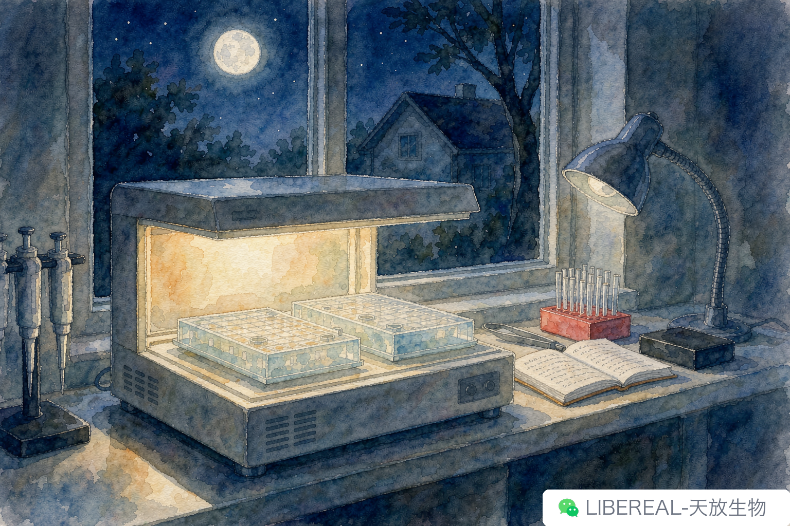

# 中秋值班记：月亮和实验数据，长得真像

> 摘要：中秋夜一个人值班，跑完胶抬头看了眼月亮，忽然觉得做科研和看月亮差不多——急也没用，等着就行。

中秋那天组里排班，我主动接了晚上。

也没啥特别的理由。师兄要回家吃饭，师姐那只细胞按点传代完刚走，老板当晚要去参加院里聚餐——剩下的就我一个在读研二的。导师问能不能扛一晚，我说行，反正宿舍就在楼下，晚饭叫外卖就行。

实验室安静下来以后，时间过得比平时慢。

九点多把那批 WB 转完膜，封闭液倒进去，回办公室泡了杯水。回到操作台前，顺手把顶上那排灯关了——窗外一轮满月，正正地悬在对面实验楼顶上。

哎，愣了一下。

平时做实验真不怎么抬头看天。白天忙得连午饭都是扒两口，晚上回去倒头就睡。中秋夜值班倒是好事，一抬头，月亮直接怼进眼睛里。

看久了就发现，月亮和实验数据有点像。

都有周期，但周期不是死数。

月亮每个月十五未必长得一模一样。有时光晕大一点，看着直径小一些；有时大气透明度高，环形山清晰得像放大镜下；赶上阴天，整月缺角。日历上写"十五月圆"，到了那晚才发现不是那么回事——满月的那个时刻，未必精确落在十五当晚，可能差到十六凌晨。

这不是说不准。朔望月平均 29 天半，天文台能算到分秒。麻烦在于，能算准的是天象，不是你能看到什么——那天晚上有没有云、你在不在窗边、灯开没开，全是变量。

WB 跑出来也是这么个事。曝光时间设一分钟，底片放进去出来，背景干净、目的条带居中——同一批样品换个日子再跑，背景可能就漂了那么零点几。Ct 值也是，今天 28.3，明天同样模板可能就是 29.1。仪器状态、试剂新鲜度、室温、上样量，每一项都在微调，结果看着差不多，其实早偏了。

做科研的人常常会犯一种毛病，拿一次结果当真。

月亮够圆够亮的时候，谁都得承认今天数据漂亮。但漂亮归漂亮，下一个周期未必复制得了。所以老一辈讲"重复三次"，不是怕失败，是怕一次的结果说谎。

都得等。

从初一到十五，十六再回初一，叫朔望月。你要是十五那天没看到，想着"今天天气不行，赶下一个十五吧"——行，那就再等二十九天。中间这二十九天月亮也没闲着，从一钩到半月到盈凸，每个阶段都在，每个阶段都有可看的。

数据也是这个理。

做不出来的时候别光想着"实验失败"。有的实验周期本来就长，质粒构建要从测序开始跑两轮，蛋白表达要等诱导时点，转基因小鼠要等繁育笼——每一步都有它的时间窗。中间那些不完美的结果、待优化的参数、待复核的对照，不是白做的，它们在给最终答案打底。

那晚值完班已经凌晨一点。实验室空调按节能模式关了，只剩冰箱嗡嗡响。关门之前我又抬头看了眼窗外，月亮已经偏西，光线斜斜地打在走廊尽头。想着再过五个小时它就落下去了，明天还会从东边起来。

研究生这三年大概也是这样，只是没人给你算好分秒。

写完这篇的时候中秋已经过了。希望你那个中秋没在加班，要是加了班，也希望你抬头看到了月亮。

下次组会上有人聊起"中秋干了啥"，我大概就笑笑说——跑了一块胶，量了个月亮。你们那天晚上，是在实验室还是在饭桌上？

---

撰稿：24级生物化学-精密移液 | 编辑：Sea | 校对：Peter
