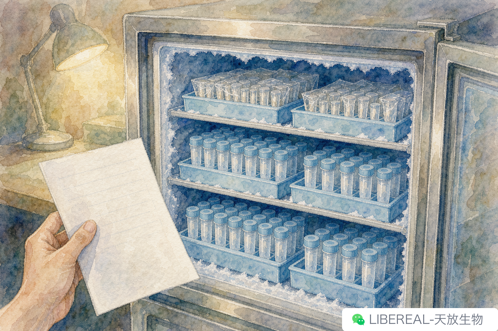

# 国庆七天长假实验室管理手册：离室前要做的七件事

> 摘要：七天长假离室前，冰箱要分装，CO₂ 要备案，培养箱要交接——七件事做完再回家。

我这人记性不好，瓶子记得倒清。每次放长假前整组都得过一遍清单，国庆这种七天长假尤其要紧。这份是这几年攒下来的，按顺序往下做，做一项划一项，全程不超过两小时。

## 一、冰箱先动手

冰箱先理，因为这一步费时间，得留够余量给后面。

先把 −80 整个盘一遍，标签朝外的留底，标签糊了的重写。批次号写清楚，效期近三个月的单独挪到一层，标红——节后回来第一眼就看到。

常温还是 4 度的东西别混放。4 度那层总有人习惯随手丢室温试剂进去，温度一拉，那瓶就废了。

分装冻存这步别省。大包装抗体反复冻融会失活，临走前分成 5–10 μL 小份再冻进去。一来防止节后开瓶一次性解冻整瓶，二来单份污染不影响其它。

效期快到的整瓶单独拍张照。冰箱门上贴张清单，节后第一批值班的人，第一件事就是核这张照。

## 二、培养箱要交接

培养箱是节中异动频繁的设备。

细胞培养这种长周期的事，国庆七天不可能停。临走前把在养的细胞分两类：能延后的，节前传一次，节后第一天接着处理；必须节中传的，找值班人员当面交接，写清日期、密度、培养基批次。

交接单我就用一个老格式：日期、细胞名、批号、传代后预计密度、值班人。五项不齐，节后回来数据乱套。

## 三、CO₂ 钢瓶要备案

培养箱 CO₂ 钢瓶的压力节前看一眼，低于 1 MPa 的直接换一瓶。备瓶摆在边上，写清更换日期。

值班的人节中如果换瓶，记录本上写时间、压力、新瓶编号。别嫌麻烦，这些记录节后排查异常数据时是关键线索。

## 四、试剂与设备关机清单

电泳仪、凝胶成像仪、PCR 仪这些用完就关的设备，节前确认断电。

水浴锅把水放干、擦净，标"已消毒待启动"。金属浴没有水，拔掉电源、清掉加热模块上的残留就行。酶标仪、化学发光成像仪检查有没有未读数据，导出备份再关。

效期敏感的试剂要在设备清单里写明位置、温度、批号。批号记下来节后有用——碰上厂家断货换批次，老批号就是回溯的起点。

## 五、值班人员通讯录

这一项常被忽略。

假期值班的，节前要拿到完整通讯录：导师、副高、技术员、动力科、维修厂家。培养箱报警、冰箱跳闸、空调漏水，这些事节中真出过。通讯录贴冰箱门上，另备一份给值班的人随身带。

## 六、数据归档

临走前那个上午做的事。新数据导出来按日期归档，记录本本周的页面拍张照备份。一个国庆过完，回来发现电脑进水硬盘挂掉，我经历过。

## 七、关门前三件事

冷柜温控面板过一遍，门关严；气瓶总阀关掉（不含 CO₂ 备瓶）；灯关。

七天没人盯，能省的设备都别留着运行，能关的总阀都关。值班的负责每天巡查一次，记温度和 CO₂ 压力。

七件做完，安心回家。节后回来按这份清单再核一遍——哪个步骤漏了，节后第一周的进度就得让位给排查。

实验室这些东西，清单有时候比说明书管用。

这七条是踩着事故攒的。你们组有没有那种"清单上没有、但每年都得提醒一次"的项目？我们这儿是插线板，年年有人忘。

---

撰稿：试剂组-冰箱贴 | 编辑：Sea | 校对：Peter
