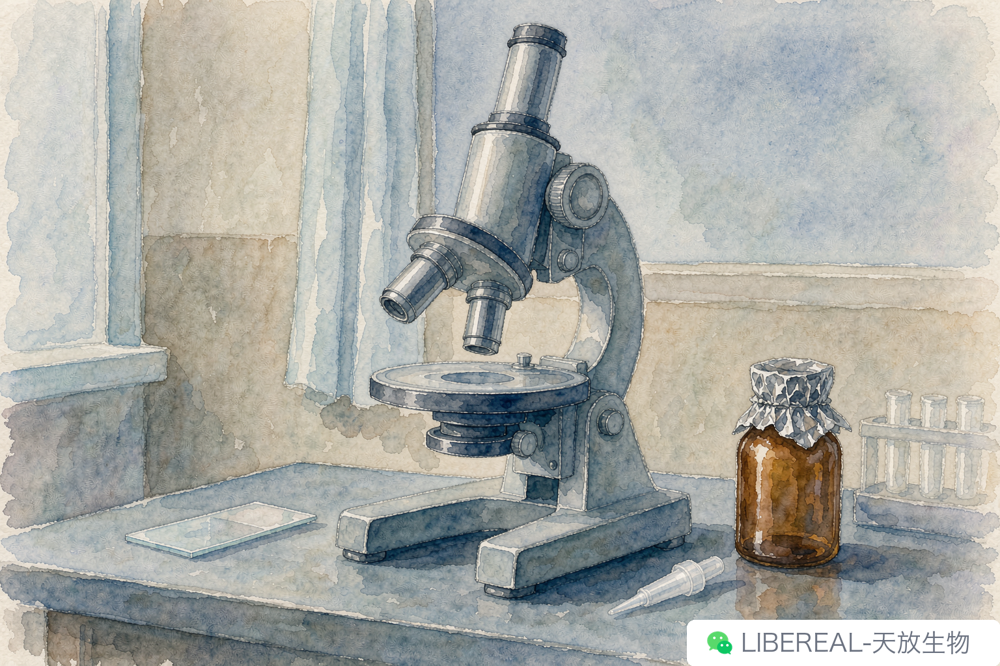

# DAPI 还是 Hoechst？核染料别闭眼选

> 摘要：核染一片糊，或者干脆染不上，先别急着怀疑染料过期——多半是这两支一开始就选错了。

上个月有个客户打电话过来，接通第一句是："你们那支 DAPI 是不是坏了，我染了三遍，核全是灰的。"

我让他把片子拍一张发过来。图一打开我就乐了——那不是灰，是整片糊着一层蓝，细胞核的轮廓压根没出来。染料没坏，是选错了支，染法也不对。

排查下来，他做的是活细胞，手边刚好只有 DAPI。

## 先说这两支差在哪

DAPI 和 Hoechst 都是往 DNA 小沟里钻的，都偏爱 AT 富集的地方，激发都在 350 nm 上下，发出来也都是 461 nm 那一片蓝。像的地方太多，很多人就觉得随便抓一支都行。

差别在两个地方。

一个在穿膜：DAPI 进活细胞很费劲，它的主场是固定样本，信号硬，价格也便宜；Hoechst 33342 能穿过去，活细胞核染色、细胞周期、凋亡时看核固缩，用的都是它。

另一个是它在细胞里待多久——Hoechst 33342 会被 ABCG2 这类转运蛋白往外泵，所以造血干细胞那套侧群分选才专门挑它。

所以下单之前只问自己一句：我这样本是死的还是活的。死的，DAPI 就挺合适；活的，得上 Hoechst 33342，浓度压到 1 到 5 μg/mL，孵个二三十分钟够了。别照着固定样本的浓度往上加，加多了细胞先垮，图还没拍呢。

顺带一提，货号这东西别光看名字。DAPI 和 Hoechst 33342 在采购单上长得一点都不像，libereal.cn 按货号搜一下，规格和现货都能看到，下单前核一遍省得来回退换。

（补一句，Hoechst 33258 跟 33342 就差几个字，通透性差一截，别拿混。）

## 那个电话后来怎么解决的

我让那位老师把 DAPI 换成 Hoechst 33342，浓度按活细胞的来，孵育时间砍到二十分钟，染完用 PBS 洗两遍再看。第二版图发过来，核一颗一颗，清清楚楚。

后来又出了个别的问题：他把母液搁在 4 度，位置靠窗。核染料怕光，母液要分装了冻在 −20，棕色管或者外面裹层锡纸。靠窗放上两个月，浓度还在，活性掉了一大截，染出来就是那种半死不活的灰蓝，跟开头那张图一个德行。

封片剂也是个常碰上的坑。普通封片剂不带抗淬灭，蓝通道衰减得特别快，上午封的片子下午再看就淡了。要留片子就上抗淬灭的那种，别省这一点。

## 多色的时候更麻烦

单染怎么都好说，一到双标三标，DAPI 那道蓝就开始惹事。它的发射峰在 461，可尾巴能拖到 500 多，FITC 或者 GFP 的通道稍微宽一点，蓝就漏进去了，看着像绿色通道里到处飘着核影子。

处理起来不复杂：发射滤光片收窄一点，染完多洗一遍，再有就是顺序——先拍绿通道再拍蓝，能少受点激发串扰。实在挤不开的，换个远红核染料，DRAQ5 那一类，通道一分开就清净了。

还有一条每次讲每次都有人点头，回头还是有人忘：这两种都是结合 DNA 的染料，废液别往下水道倒，戴手套操作，按有害废液收。

核染出问题，来来回回就那几个地方：支选错、浓度不对、母液见了光、封片剂没抗淬灭。真卡住的那一刻先别怀疑瓶子，把自己这套流程从头过一遍——多数时候问题不在试剂上。

行了，手头还有个电话要回。你那套通道配置要是实在拿不准，把滤光片和染料名字写下来，发我看看。

---

撰稿：售后-急救包 | 编辑：Sea | 校对：Peter
