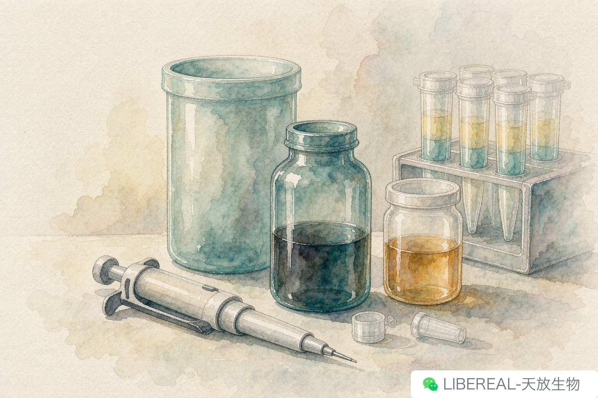

# 质粒提得少，从菌液到洗脱挨着查一遍

> 摘要：同一盒试剂盒，隔壁组提到 500 ng/μL，你这边连 100 都不到。这种差距，十有八九出在菌液和裂解那两步。

上礼拜连着提了三管质粒，浓度一次比一次低，第三管只有 70 出头。柱子是新的，试剂盒刚拆封，我把离心转速、裂解时间、洗脱体积挨着核了一遍，一样没动过。

后来发现问题在摇瓶里。那瓶菌摇过了头，OD600 快到 3，菌体开始自溶，裂解液一加进去就黏得拉丝。得，白忙一上午。

## 菌摇过头，裂解液一加就拉丝

提质粒这事儿，收菌那一下基本上就定了一半。对数中后期收，OD600 落在 0.8 到 1.5 之间，菌体状态好，质粒拷贝数也稳；摇到平台期再往下拖，细胞壁开始破，基因组 DNA 一起漏出来，裂解液黏得能挑成丝，后面的柱子根本吃不住这个黏度。甘油菌反复传代更要留意，传上几轮质粒容易丢或者重排，带重复序列的构建尤其明显；真做长了，隔一阵子从原始甘油管重新划一次板，比每次都从上一板挑靠谱。说明书只管裂解往后那几步，前面这段得自己盯。

菌量也得配得上柱子。1.5 mL 菌液是常规，低拷贝质粒或者大质粒得往上加，但别一股脑倒五毫升进去——硅胶膜就那么点结合容量，菌体过载的结果是裂解不彻底，上清里混着没散开的团块，看着量挺大，实际提得干净的部分没多少。

还有个隐蔽的：抗生素。氨苄在培养液里放久了会降解，平板搁冰箱两三周更是明显。这时候长出来的菌落里，有一半压根没带质粒，摇得再旺也是替别人忙活。带质粒的菌背着复制负担，长得本来就慢，一不留神就被没质粒的追过去了。新鲜平板、单菌落挑起、抗生素现加，这三样省不得。

菌株本身也挑。DH5α、TOP10 这类 endA1 背景的，核酸酶少，制品干净；HB101 那类 endA+ 的菌株，胞内核酸酶容易跟着走完全程，浓度测着不低，转染或者酶切的时候就现原形。要是手上的构建一直提不稳，翻一下甘油菌的记录，看当初是拿什么菌株转化的。

## 裂解那五分钟

重悬这步常被跳过去。Solution I 没把菌团吹散，后面碱液进去就是外头一层先裂、里头还是一团，RNA 酶也没机会铺开。吹到肉眼看不出颗粒再往下走，多花三十秒的事。

Solution II 是 0.2 M NaOH 加 1% SDS，碱负责把双链拆开，SDS 破膜、顺手把蛋白裹住。时间卡在三四分钟，别超五分钟。放久了基因组 DNA 会断成小片段，变性了也回不去，中和之后跟着上清一起上柱，A260/280 看着还挺漂亮，跑胶才发现拖尾一片。反过来时间给少了，菌没裂透，质粒还锁在细胞里，洗脱液再怎么预热也提不出来。II 液开封久了会吸空气里的二氧化碳，碱浓度悄悄往下掉，一支用了一整个月的旧瓶子，往往就是浓度慢慢滑坡的原因。这步真别赶。拖久了更麻烦。

加完 II 液只能轻轻颠倒，不能涡旋。

涡旋那一下把长链基因组 DNA 打成碎片，后面就没法靠絮状沉淀把它捞干净了。中和液 III 进去、冰上放几分钟，白色絮状物浮起来，离心取上清，清亮得能看见管底的影子才算过关。上周那管拉丝的，就是菌太多、II 液没散匀，局部碱不够，裂解半生不熟。

## 洗脱前，先看一眼洗液瓶

Wash Buffer 的浓缩瓶上写着“加乙醇”，这一勾见过好几回是空着的。瓶里少了乙醇，DNA 就贴不住膜，头一遍洗涤能把样品直接冲走，后面再怎么离心也只剩个空管子。新开一瓶，先倒乙醇，再划勾，别指望记性。

上清没澄清就上柱也常见。絮状物带进膜里，堵了流速，洗脱体积还是那些，回收率就下去了。多离一次不亏。取上清时少吸一点，别贴着沉淀吸。

洗脱液别拿超纯水凑合。水放久了 pH 偏酸，DNA 从膜上下来得费劲；10 mM Tris-HCl、pH 8.5 那一类就挺合适，libereal.cn 按货号能查到规格和现货，顺手核一下 pH。加到膜中央，静置一两分钟再离心，比滴上去立刻转能多回收一截。大质粒可以先把洗脱液温到 50 度上下。体积压小，浓度上去了，总量会吃亏；分两次洗脱能多捞回一些，就是得把两管合一管。两头都占的好事不多。

测出来数字不对，也别急着回头骂菌。RNase A 失活的话 RNA 会一起算进 A260，读数虚高，跑胶却是一堆小分子的糊带，超螺旋那条反倒不亮；A260/230 掉到 1.5 以下，多半是盐或者胍残留，多洗一遍能救。浓度和纯度得对着胶图一起看，光盯着一个数字容易冤枉人。

那管 70 出头的后来没舍得扔，管壁上贴了张小标签，写着“摇过头”。下回再提不动，我先看摇瓶，别急着换柱子。你们组要是也卡在这种地方，把摇瓶的 OD 和洗脱体积记一笔，下回翻出来对照，省得从头再猜。

---

撰稿：技术支持-对照组 | 编辑：Sea | 校对：Peter
