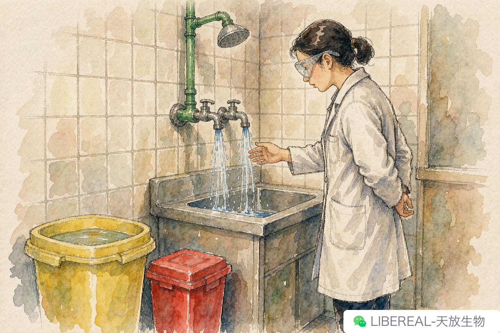

# 安全检查前一周，全组在给瓶子贴标签

> 摘要：学院通知下周查安全，我们组提前一周开始收拾，收出来的东西比想象中多——包括一瓶没人认领的 2019 年试剂。

周一下午三点多，群里弹出一条消息，一行字：下周二学院查实验室安全，各组合规自查。没人回。

过了两分钟，师姐发了个"收到"。接着后面一排"收到"，队伍整齐得像军训。

我入学三个多月，头一回碰上这事。原来检查不是进来转一圈看干不干净，是拿着一张表逐项对，对不上就记分。那张表我看了一眼，密密麻麻，比我们组的仪器清单还长。

那周组里的状态，大概可以叫搬家。

## 冰箱里翻出一瓶 2019 年的

贴标签占了头两天。师姐打印了一沓标签纸，规定四样：名称、浓度、配制日期、配制人。四个人分两层，一层一层往外掏。

掏到第二层，出来一瓶棕色瓶，标签黄透，字迹糊成一片，谁也看不出是什么。挨个问了组里所有人，连已经毕业的师兄都微信问了，没人认。师姐说这种麻烦，无主试剂不能随手倒下水道，得按危废交上去，还得写份说明。

我第一次知道，一瓶没人认的试剂，处理它比买它费事。

掏出来的东西也不少。过期三年的培养基、干在瓶底的抗体、用了一半又塞回冰箱的封闭液，还有半盒不知道谁买的枪头，盒子都软了。该扔的装危废，能留的重新贴。师姐边贴边说，标签上不写日期，等于没写——出了事查不到哪天配的，这瓶就是来路不明。

冰箱温度记录本也翻出来看了。十月有一周空着，那几天没人上班。空着就是空着，师姐没让补，说老师一问那天谁值班，补上去更难看。

## 插排串成了糖葫芦

这块是重灾区。

烘箱旁边那个插排上，又插了一个插排，接着烘箱、真空泵，还有一个冬天取暖用的小太阳。检查表里明确不许串联，大功率设备也不许走普通插排。师姐说这台烘箱的线她自己都烫过手。

墙角 CO₂ 钢瓶之前就拿一根绳拴在架子上，绳还是松的。这次换了链条，绕两圈扣死。液氮罐挪到通风的角落，盖子留了缝，别让它憋着压。

走廊那堆纸箱清了两天，收废品的师傅来了三趟。原来那堆东西堵在消防通道上，属于一查就扣分的项，平时谁都觉得"就放两天"。

## 废液桶、利器盒，规矩细到刻度

废液桶上要写清成分，含卤和不含卤不能混。桶装到四分之三就得换，超了搬运时容易洒。我们那个桶早就过了线，一直没人管，这回被师姐盯着换掉。

利器盒的讲究我之前完全不知道。针头不能回套针帽，盒子装到四分之三封口，不能压不能挤。师姐说她见过有人把用过的针头插在泡沫板上放着，这比不收拾还危险。

跑完的胶也不能扔普通垃圾。含核酸染料的胶属于危废，得单独收。手套摘下来不能乱放，更不能戴着去开门、按电梯。

还有洗眼器。我一直以为是墙上的摆设。原来每周要放一次水冲管道，不然管里存的水会生锈、长菌，真要用的时候先喷一脸脏水。

顺带一提，标签纸、利器盒、废液桶这些耗材，libereal.cn 上按规格能查到，别等检查前一天才发现盒子空了。

## 检查那天

老师进门先看门后的灭火器，把压力表凑近看指针，又让我们当场开一次洗眼器。

然后问离心机上次维护是什么时候。全组沉默。记录本在，上一条是 8 月。

冰箱温度记录停了一周的，也被看到了。危化品台账、安全培训记录、值日表，一样一样翻。走的时候记了三条：走廊又堆了两个刚到的快递箱，一处插排串联没拆干净，冰箱里两瓶没标签。

老师走之前说了一句话，我记住了。他说检查不是来挑毛病，是看你们平时有没有把该记的记下来。

行吧。

反正我现在看见没标签的瓶子，手就痒，忍不住想给它贴一张。你们组要是刚被查完，把扣分项发我一份，我照着抄，省得下回再被点到名。

---

撰稿：25级微生物学-新开封 | 编辑：Sea | 校对：Peter
